<!-- ═══════════════════════════════════════════════════════════════════════════════ -->
<!--                                                                               -->
<!--    MOHAMED LAMINE SAIDANE · BENTO GRID PORTFOLIO                              -->
<!--    Aesthetic: Modern Minimalist / Linear & Vercel Inspired                    -->
<!--    Palette: Deep Obsidian (#090d16), Slate (#94a3b8), Electric Cyan (#38bdf8) -->
<!--                                                                               -->
<!-- ═══════════════════════════════════════════════════════════════════════════════ -->

<!-- ────────────── 1. AMBIENT GLOW HERO BANNER ────────────── -->
<!-- Why this exists: A custom-built, vector SVG banner stored right inside the repository.
     It loads in <50ms, never times out, and eliminates any dependency on third-party servers. -->

<!-- ────────────── 2. DYNAMIC STATUS & ROLES ────────────── -->
<!-- Why this exists: Highlights key career distinctions with a smooth typing ticker -->
 

[+%F0%9F%9A%80)](https://git.io/typing-svg)

 

<!-- ────────────── 3. QUICK NAVIGATION BAR ────────────── -->
<!-- Why this exists: Gives recruiters immediate 1-click access to verified status, email, and LinkedIn -->

&nbsp;

&nbsp;

&nbsp;

&nbsp;

 

<!-- ═══════════════════════════════════════════════════════════════════════════════ -->
<!--  BENTO ROW 1: PROFILE & ACADEMICS (LEFT) + ANIME CODER & STREAK (RIGHT)        -->
<!-- ═══════════════════════════════════════════════════════════════════════════════ -->

<table width="100%" border="0" cellpadding="8" cellspacing="0">
<tr>

<!-- Bento Card A: Engineering Profile -->
<td width="55%" valign="top">
<h3>📌 About Me</h3>

I am an **AI & Software Engineering student at ESPRIT** with a strong foundation in backend architecture, full-stack systems, and applied machine learning.

- 🎓 **Current**: AI & Software Engineering Track @ **ESPRIT** (2024 – Present)
- 🏅 **Undergraduate**: B.Sc. in Software Engineering (GLSI) @ **FSM** — Graduated **Mention Très Bien**
- 🔭 **Specialization**: High-throughput distributed backends, clean microservices & predictive AI
- 🌍 **Location**: Tunis, Tunisia 🇹🇳
- 🎯 **Target**: Seeking a **Stage d'État** (Final Graduation Internship) starting early 2025/2026
- 💬 **Languages**: French (*Bilingual*), English (*Professional*), Arabic (*Native*)

 

> *"Simplicity is prerequisite for reliability."* — **Edsger W. Dijkstra**

</td>

<!-- Bento Card B: Developer Sanctuary (Anime Coder + Live Streak) -->
<td width="45%" valign="top" align="center">
<h3>⚡ Dev Sanctuary</h3>

<!-- Cyberpunk Anime Coder Companion (Self-hosted in repository, instant load) -->

 

  

<!-- Desk Companion Detail: Cute Animated Coding Cat -->

  
<b>🐱 Desk Companion: Animated Coding Cat</b>

   
  

 

<!-- Live GitHub Streak Stats (High reliability demolab endpoint) -->

</td>

</tr>
</table>

 

<!-- ═══════════════════════════════════════════════════════════════════════════════ -->
<!--  BENTO ROW 2: FEATURED PRODUCTION PROJECTS                                      -->
<!-- ═══════════════════════════════════════════════════════════════════════════════ -->

<h3>🚀 Featured Projects</h3>

<table width="100%" border="0" cellpadding="10" cellspacing="0">
<tr>

<!-- Project 1: SmartBiz AI -->
<td width="50%" valign="top">
<h4>🏅 <a href="https://github.com/Mohamedamine2004/PFE-smartBiz-AI">PFE — SmartBiz AI</a></h4>

<b>AI-Powered SaaS Platform for SME Management & Valuation</b>

Final graduation project awarded <b>Mention Très Bien</b> 🎖️. Centralizes operational business metrics, automates business valuation using <b>CatBoost Machine Learning</b>, and delivers predictive financial intelligence for executive decision-making.

  
  
  
  
  

<a href="https://github.com/Mohamedamine2004/PFE-smartBiz-AI"><b>View Source Code →</b></a>
</td>

<!-- Project 2: Money Track Mood -->
<td width="50%" valign="top">
<h4>💡 <a href="https://github.com/Mohamedamine2004/Money_Track_Mood">Money Track Mood</a></h4>

<b>Behavioral Finance & Mood-Linked Expense Tracker</b>

A full-stack production web application correlating daily spending habits with psychological emotional states. Surfaces impulsive buying patterns and behavioral triggers through rich, interactive data visualizations.

  
  
  
  
  

<a href="https://github.com/Mohamedamine2004/Money_Track_Mood"><b>View Source Code →</b></a>
</td>

</tr>
</table>

 

<!-- ═══════════════════════════════════════════════════════════════════════════════ -->
<!--  BENTO ROW 3: TECHNOLOGY ARSENAL                                               -->
<!-- ═══════════════════════════════════════════════════════════════════════════════ -->

<h3>🛠️ Tech Arsenal</h3>

<table width="100%" border="0" cellpadding="8" cellspacing="0">
<tr>

<td width="50%" valign="top">
<b>🎨 Frontend & User Interface</b> 

  
<b>⚙️ Backend Systems & Languages</b> 

</td>

<td width="50%" valign="top">
<b>🗄️ Databases & Infrastructure</b> 

  
<b>🧠 AI / ML, Automation & Tools</b> 

</td>

</tr>
</table>

 

<!-- ═══════════════════════════════════════════════════════════════════════════════ -->
<!--  BENTO ROW 4: INTERACTIVE CONTRIBUTION ACTIVITY                                 -->
<!-- ═══════════════════════════════════════════════════════════════════════════════ -->

<h3>📈 Contribution Activity</h3>

<!-- Live GitHub Contribution Calendar (Instant 200 OK, Always Active) -->

  

<!-- Interactive Physics Simulation (Powered by flycran/github-gravity) -->

  
<b>🪐 Expand Physics Gravity Simulation</b>

   
  
<i>Physics simulation of contribution activity blocks colliding over <b>LAMINE SAIDANE</b></i>

  <picture>
    <source media="(prefers-color-scheme: dark)" srcset="https://raw.githubusercontent.com/Mohamedamine2004/Mohamedamine2004/output/gravity.svg">
    <source media="(prefers-color-scheme: light)" srcset="https://raw.githubusercontent.com/Mohamedamine2004/Mohamedamine2004/output/gravity.svg">
    
  </picture>

 

<!-- ═══════════════════════════════════════════════════════════════════════════════ -->
<!--  BENTO ROW 5: CONTACT & FOOTER                                                 -->
<!-- ═══════════════════════════════════════════════════════════════════════════════ -->

<h3>🤝 Let's Connect & Collaborate</h3>

I am actively seeking a <b>Stage d'État (Final Graduation Internship)</b> in Full-Stack & AI Engineering.

&nbsp;&nbsp;

&nbsp;&nbsp;

  

<!-- Self-Hosted SVG Footer Banner -->

